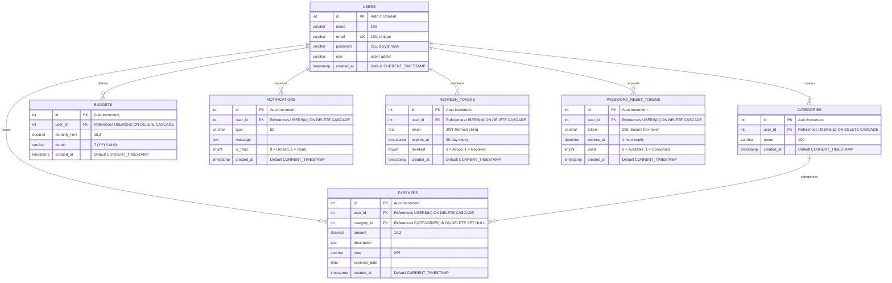

# 🗄️ Database Schema Documentation — Expense Tracker Platform

> **Database Engine:** MySQL 8.0+  
> **Default Charset:** `utf8mb4`  
> **Default Collation:** `utf8mb4_0900_ai_ci`  
> **SQL Schema Files:** [`schema.sql`](file:///d:/owned_projects/Expense_Tracker/schema.sql) | [`backend/schema.sql`](file:///d:/owned_projects/Expense_Tracker/backend/schema.sql)

---

## 1. Entity-Relationship (ER) Diagram



---

## 2. Table-by-Table Data Dictionary

### 2.1 `users`
Master table containing user identities, authentication hashes, and system roles.

| Column | Data Type | Nullable | Key | Default | Description |
| :--- | :--- | :---: | :---: | :---: | :--- |
| `id` | `INT` | ❌ No | **PK** | `AUTO_INCREMENT` | Unique user identifier |
| `name` | `VARCHAR(100)` | ❌ No | | None | Full legal or display name |
| `email` | `VARCHAR(150)` | ❌ No | **UK** | None | Primary login email address |
| `password` | `VARCHAR(255)` | ❌ No | | None | Secure Bcrypt password hash |
| `role` | `VARCHAR(20)` | ✔️ Yes | | `'user'` | Access level: `'user'` or `'admin'` |
| `created_at` | `TIMESTAMP` | ✔️ Yes | | `CURRENT_TIMESTAMP` | Account creation timestamp |

---

### 2.2 `categories`
Categories for transaction classification. Can be platform templates or user-custom.

| Column | Data Type | Nullable | Key | Default | Description |
| :--- | :--- | :---: | :---: | :---: | :--- |
| `id` | `INT` | ❌ No | **PK** | `AUTO_INCREMENT` | Category ID |
| `user_id` | `INT` | ✔️ Yes | **FK** | `NULL` | Owner user (`NULL` = platform default) |
| `name` | `VARCHAR(100)` | ❌ No | | None | Category name (`Food`, `Travel`, etc.) |
| `created_at` | `TIMESTAMP` | ✔️ Yes | | `CURRENT_TIMESTAMP` | Category creation date |

* **Foreign Key**: `user_id` references `users(id)` `ON DELETE CASCADE`.

---

### 2.3 `expenses`
The core transactional ledger storing individual expense entries.

| Column | Data Type | Nullable | Key | Default | Description |
| :--- | :--- | :---: | :---: | :---: | :--- |
| `id` | `INT` | ❌ No | **PK** | `AUTO_INCREMENT` | Transaction ID |
| `user_id` | `INT` | ✔️ Yes | **FK** | `NULL` | User who incurred expense |
| `category_id` | `INT` | ✔️ Yes | **FK** | `NULL` | Category classification |
| `amount` | `DECIMAL(10,2)` | ❌ No | | None | Transaction value in currency |
| `description` | `TEXT` | ✔️ Yes | | `NULL` | Payee / item description |
| `note` | `VARCHAR(255)` | ✔️ Yes | | `NULL` | Short optional memo |
| `expense_date` | `DATE` | ❌ No | **INDEX**| None | Date of expense |
| `created_at` | `TIMESTAMP` | ✔️ Yes | | `CURRENT_TIMESTAMP` | System record insertion timestamp |

* **Foreign Keys**:
  * `user_id` references `users(id)` `ON DELETE CASCADE`.
  * `category_id` references `categories(id)` `ON DELETE SET NULL`.

---

### 2.4 `budgets`
Monthly expenditure ceilings and warning boundaries.

| Column | Data Type | Nullable | Key | Default | Description |
| :--- | :--- | :---: | :---: | :---: | :--- |
| `id` | `INT` | ❌ No | **PK** | `AUTO_INCREMENT` | Budget record ID |
| `user_id` | `INT` | ❌ No | **FK, UK** | None | User setting the budget |
| `monthly_limit` | `DECIMAL(10,2)` | ❌ No | | None | Max monthly spending ceiling |
| `month` | `VARCHAR(7)` | ❌ No | **UK** | None | Target month format: `YYYY-MM` |
| `created_at` | `TIMESTAMP` | ✔️ Yes | | `CURRENT_TIMESTAMP` | Setup timestamp |

* **Unique Constraint**: `UNIQUE KEY (user_id, month)` — Guarantees only 1 budget per user per month.
* **Foreign Key**: `user_id` references `users(id)` `ON DELETE CASCADE`.

---

### 2.5 `notifications`
System alerts, budget threshold breaches, and transactional status updates.

| Column | Data Type | Nullable | Key | Default | Description |
| :--- | :--- | :---: | :---: | :---: | :--- |
| `id` | `INT` | ❌ No | **PK** | `AUTO_INCREMENT` | Notification ID |
| `user_id` | `INT` | ❌ No | **FK** | None | Recipient user |
| `type` | `VARCHAR(50)` | ✔️ Yes | | `NULL` | E.g., `Budget Alert`, `System` |
| `message` | `TEXT` | ✔️ Yes | | `NULL` | Full alert text body |
| `is_read` | `TINYINT(1)` | ✔️ Yes | | `0` | Status (`0` = unread, `1` = read) |
| `created_at` | `TIMESTAMP` | ✔️ Yes | | `CURRENT_TIMESTAMP` | Sent timestamp |

* **Foreign Key**: `user_id` references `users(id)` `ON DELETE CASCADE`.

---

### 2.6 `refresh_tokens`
Long-lived persistent JWT refresh sessions supporting multi-device login, rotation, and revocation.

| Column | Data Type | Nullable | Key | Default | Description |
| :--- | :--- | :---: | :---: | :---: | :--- |
| `id` | `INT` | ❌ No | **PK** | `AUTO_INCREMENT` | Token ID |
| `user_id` | `INT` | ❌ No | **FK** | None | User associated with the session |
| `token` | `TEXT` | ❌ No | | None | Cryptographic JWT refresh token |
| `expires_at` | `TIMESTAMP` | ❌ No | | None | Expiration limit (90 days) |
| `revoked` | `TINYINT(1)` | ✔️ Yes | | `0` | Revocation status (`1` = revoked) |
| `created_at` | `TIMESTAMP` | ✔️ Yes | | `CURRENT_TIMESTAMP` | Generation timestamp |

* **Foreign Key**: `user_id` references `users(id)` `ON DELETE CASCADE`.

---

### 2.7 `password_reset_tokens`
Single-use, 1-hour secure password reset tokens sent via Gmail SMTP.

| Column | Data Type | Nullable | Key | Default | Description |
| :--- | :--- | :---: | :---: | :---: | :--- |
| `id` | `INT` | ❌ No | **PK** | `AUTO_INCREMENT` | Token record ID |
| `user_id` | `INT` | ❌ No | **FK, INDEX** | None | User requesting reset |
| `token` | `VARCHAR(255)` | ❌ No | **INDEX** | None | Secure random hex reset token |
| `expires_at` | `DATETIME` | ❌ No | | None | 1-hour expiration ceiling |
| `used` | `TINYINT(1)` | ✔️ Yes | | `0` | Single-use flag (`1` = consumed) |
| `created_at` | `TIMESTAMP` | ✔️ Yes | | `CURRENT_TIMESTAMP` | Dispatch timestamp |

* **Foreign Key**: `user_id` references `users(id)` `ON DELETE CASCADE`.

---

## 3. How to Import & Run the Schema

### Option A: Using MySQL Command Line
```bash
# Connect and import schema directly
mysql -u root -p < schema.sql
```

### Option B: Using PowerShell
```powershell
Get-Content schema.sql | mysql -u root -p
```

### Option C: Using MySQL Workbench / phpMyAdmin / DBeaver
1. Open MySQL Workbench / phpMyAdmin / DBeaver.
2. Open [`schema.sql`](file:///d:/owned_projects/Expense_Tracker/schema.sql).
3. Execute the entire script (Ctrl+Shift+Enter in Workbench).
4. The database `expense_tracker` will be created with all 7 tables and foreign key constraints.

